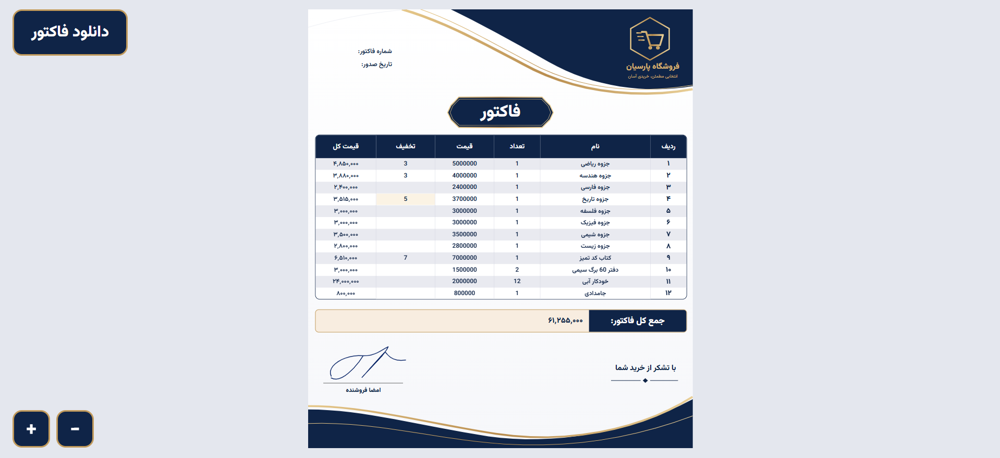

# Invoice Maker (Django)

<p align="center">
  
</p>

A simple web app to create invoices in Persian (right-to-left).
The user fills in the items, clicks one button, and the invoice is **saved in the database** and **downloaded as a PDF**.

## Features

- Invoice design in Persian (RTL), with a navy and gold theme
- 12 item rows: name, quantity, price, and discount
- **Live calculation** of each row total and the grand total while typing
- Discount from 0 to 100 percent
- One button, **"دانلود فاکتور"** (Download invoice), that:
  1. sends the data to Django and saves it,
  2. fills in the invoice number and the date (Persian calendar),
  3. downloads the invoice as a PDF
- The page always fits the screen, and has zoom buttons (+ / −) for a bigger view
- Server-side validation (empty rows are skipped, wrong values are rejected)

## Tech stack

- **Backend:** Python, Django
- **Database:** PostgreSQL
- **Run with:** Docker and Docker Compose
- **Frontend:** HTML, CSS, JavaScript (no framework)
- **PDF:** [html2canvas](https://html2canvas.hertzen.com/) and [jsPDF](https://github.com/parallax/jsPDF), loaded from cdnjs
- **Font:** Vazirmatn (Google Fonts)

## How it works

```
Browser                               Django
-------                               ------
user fills the table
clicks "دانلود فاکتور"  --POST-->     CreateInvoiceView.post()
                                      - reads the rows
                                      - validates every row with a form
                                      - creates Invoice + InvoiceItem objects
                        <--JSON--     {"ok": true, "invoice_id": 1, "created": "2026-11-08"}
shows number and date
makes the PDF and downloads it
```

If something is wrong, Django answers `{"ok": false, "error": "..."}` and the page shows the message instead of downloading.

## Data models

| Model | Fields |
| --- | --- |
| `Invoice` | `created` (date, set automatically), `total_invoice` (property: sum of all item totals) |
| `InvoiceItem` | `invoice`, `title`, `quantity`, `price`, `discount` (0 to 100), `total_amount` (calculated in `save()`) |

The server always calculates `total_amount` itself, so the browser cannot send a fake total.

## Run the project

### Option 1: Docker (recommended)

You need [Docker](https://docs.docker.com/get-docker/) with Docker Compose.

**1. Clone the project**

```bash
git clone <your-repository-url>
cd <project-folder>
```

**2. Create the `.env` file**

Copy the example file and change the values:

```bash
cp .env.example .env
```

The file has the database settings:

```env
POSTGRES_DB=invoices
POSTGRES_USER=invoices_user
POSTGRES_PASSWORD=change-me
```

> Inside Docker, Django must connect to the database with the host name `invoices-db` (the service name in `docker-compose.yml`) and port `5432`, not `localhost`.

**3. Build and start**

```bash
docker compose up --build -d
```

This starts two containers:

| Service | What it does |
| --- | --- |
| `invoices-db` | PostgreSQL database (data is kept in the `postgres_data` volume) |
| `app` | The Django app, on port 8000 |

**4. Create the database tables**

```bash
docker compose exec app python manage.py migrate
```

**5. (Optional) Create an admin user**

```bash
docker compose exec app python manage.py createsuperuser
```

**6. Open the app**

- Invoice page: <http://localhost:8000/>
- Admin panel: <http://localhost:8000/admin/>

**Useful commands**

```bash
docker compose logs -f app      # see the app logs
docker compose stop             # stop the containers (data is kept)
docker compose up -d            # start them again
docker compose down             # remove the containers (data is kept)
docker compose down -v          # remove the containers AND the database data
```

### Option 2: Without Docker

You need Python 3.11 and a running PostgreSQL database.

```bash
python -m venv venv
source venv/bin/activate        # Windows: venv\Scripts\activate
pip install -r requirements.txt
```

Set the database values from `.env.example` in your environment (use `localhost` as the database host), then:

```bash
python manage.py migrate
python manage.py runserver
```

Open <http://127.0.0.1:8000/>.

## Usage

1. Write the item name, quantity, and price in each row (discount is optional).
2. Watch the row totals and the grand total update.
3. Click **دانلود فاکتور** in the top-left corner.
4. The PDF is downloaded, and the invoice is saved. You can see it in the Django admin.

## Project structure

```
.
├── Dockerfile
├── docker-compose.yml
├── .env.example           # copy it to .env
├── requirements.txt
├── manage.py
└── invoices/
    ├── models.py          # Invoice and InvoiceItem
    ├── forms.py           # validation for one item row
    ├── views.py           # CreateInvoiceView (GET page, POST save)
    ├── urls.py            # path "" -> CreateInvoiceView
    └── templates/
        └── invoices/
            └── home.html  # invoice page (HTML, CSS, JS)
```

## Notes

- The PDF libraries come from a CDN, so the page needs internet. To work offline, download the two files into your `static` folder and change the two `<script src=...>` lines in `home.html`.
- The CSRF token is sent with the POST request, so Django's protection stays on.
- The Docker setup uses Django's development server (`runserver`). It is good for learning and testing. For a real server, use Gunicorn and turn `DEBUG` off.
- Never commit the real `.env` file. Commit only `.env.example`.

## Ideas for the future

- A page to view a saved invoice again
- Customer name and phone number
- Expiry date for the invoice
- Invoice list with search
- Login for the seller

## Author

Amirali Ghalenoei
GitHub: [AmirAliGhalenoei](https://github.com/AmirAliGhalenoei)